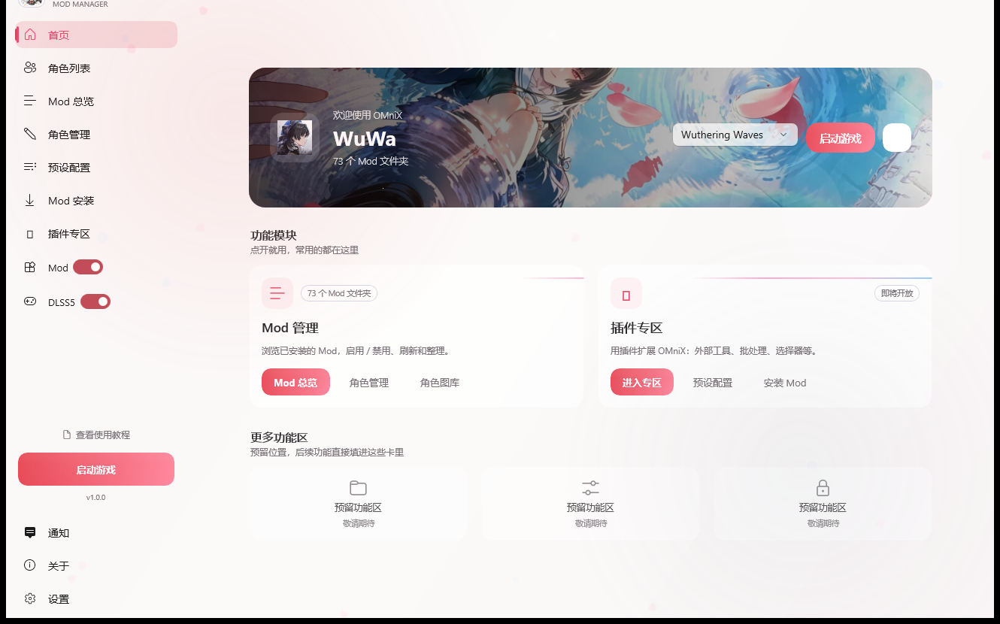

# OMniX · 是湫

鸣潮（WuWa）的 Mod 管理器。Windows 桌面应用，WinUI 3 / .NET 9 写的。

使用说明书：[使用说明书.md](使用说明书.md)　·　英文说明：[README_EN.md](README_EN.md)　·　免责声明：[DISCLAIMER.md](DISCLAIMER.md)　·　许可：[GPL-3.0](LICENSE)

当前版本：**1.1.1**



---

## ⚠️ 先说最要紧的：这软件是免费的

OMniX **完全免费、开源**。没有会员版，没有激活码，也没有任何需要付费才能解锁的功能。

如果有人跟你要钱才给安装包，或者卖你「激活码」「会员版」—— **那就是骗子**。
直接拒绝就好，顺手到交流群或者 GitHub 上说一声，别让下一个人上当。

正经的获取途径只有两个：

1. 本仓库的 [Releases](https://github.com/aiertana/OMnix/releases)
2. 交流群里的群文件

其它渠道拿到的安装包，请不要用。


---

## 它能做什么

| 功能 | 说明 |
|---|---|
| **角色管理** | 所有角色以头像墙列出，可搜索、置顶、隐藏；角色也能自己新建（内部名、关键字、稀有度、属性、头像） |
| **Mod 开关** | 单个 Mod 或整个角色一键启用 / 禁用，实质是给 Mod 文件夹加 `DISABLED_` 前缀 |
| **Mod 预设** | 把一套 Mod 组合存成预设，切换时批量应用；预设可重命名、复制、导出到文件 |
| **Mod 编辑** | 改 Mod 的名称、作者、描述、星级，调整 Mod 内部的分段与优先级，导入 / 替换预览图 |
| **Mod 回收站** | 删掉的 Mod 会先进回收站，误删能恢复 |
| **更新检测** | 比对本地 Mod 文件时间戳，把有变动的 Mod 标出来 |
| **Mod 修复** | 集成 Wuwa Mod Fixer，可以直接在程序里下载并运行 |
| **启动游戏** | 配好路径后直接拉起 XXMI Launcher 和游戏本体；没装启动器会提示去下载或手动指定 |
| **Mod 迁移** | Mod 可以在角色之间移动，也可以复制 |

角色、预设、Mod 的开关状态都保存在本地，换台机器拷过去就能接着用。

---

## 第一次用

1. 解压后双击 `启动OMniX.exe`（不弹黑窗，直接把主程序拉起来）。
   第一次启动会慢一点，因为自包含版本要先解压运行时；不需要另外装 .NET。
2. 进入「首次启动」引导页，游戏选「鸣潮」。
3. 它会问你 **XXMI Launcher 的文件夹**在哪 —— 选 XXMI Launcher 所在的目录，
   例如 `D:\mod\XXMI Launcher`。程序会自动认出里面的启动程序，并推导出 Mods 文件夹。
4. 没装 XXMI Launcher 的话，点界面上的「启动器」按钮，会提示去
   <https://github.com/SpectrumQT/XXMI-Launcher/releases/latest> 下载，或者自己手动指定路径。

> Mod 文件本体在 XXMI Launcher 的 `WWMI\Mods` 里，这个管理器只是引用它们，不自带任何 Mod。

完整的图文说明（安装、界面、各项功能、设置、常见问题）见 **[使用说明书.md](使用说明书.md)**。

---

## 数据存在哪

```
C:\Users\<用户名>\AppData\Local\OMniX\
├─ ApplicationData_WuWa\    鸣潮的数据
│  ├─ GameService.json      角色定义
│  ├─ LocalSettings.json    设置（含 Mods 文件夹路径）
│  ├─ commands.json         启动器 / 游戏启动命令
│  └─ Presets\              预设
└─ game.json                当前选中的游戏
```

Mod 文件本身**不在**这里，在 XXMI Launcher 的 `WWMI\Mods` 下。

---

## 源码与构建

这个仓库放的是**源码**。不想自己编译的话，打好的程序去
[Releases](https://github.com/aiertana/OMnix/releases) 下载 `OMniX1.1.1.zip`，解压即用。

### 需要什么

- Windows 10 2004 及以上（内部版本 10.0.19041）
- [Visual Studio 2022](https://visualstudio.microsoft.com/)，勾选「.NET 桌面开发」
  和「Windows 应用开发」两个工作负载
- **C++ 桌面开发组件**：提权辅助 `Elevator` 是 C++ 项目，没装这个工作负载编译会失败

### 编译运行

Visual Studio 打开 `src/OMniX.sln`，把 `OMniX.WinUI` 设为启动项目，平台选 **x64**，按 F5。

命令行也行：

```bat
dotnet build src\OMniX.WinUI\OMniX.WinUI.csproj -c Debug -p:Platform=x64
```

### 出发布包（自包含，给别人的机器上不用装 .NET）

```bat
dotnet publish src\OMniX.WinUI\OMniX.WinUI.csproj -c Release -p:Platform=x64 /p:PublishProfile=FolderProfileSelfContained
```

产物在 `src\OMniX.WinUI\bin\Release\Publish\`。把它整个拷出来，
配上一个无窗口启动器就是 Release 里那个包。

### 仓库里有什么

```
OMniX/
├─ src/                   源码
│  ├─ OMniX.WinUI/           主程序（WinUI 3 / .NET 9），界面全在这里
│  ├─ OMniX.Core/            Mod 处理、GameBanana 客户端、游戏服务
│  ├─ OMniX.AutoUpdater/     自动更新器
│  ├─ OMniXLauncher/         启动器源码
│  ├─ Elevator/              提权辅助（C++）
│  └─ GenshinGenerator/  Tools/  UpdateGenshinAssets/   生成 asset 用的小工具
├─ Images/                界面预览图
├─ README.md              项目首页
├─ README_EN.md           英文说明
├─ DISCLAIMER.md          免责声明
├─ LICENSE                GPL-3.0
├─ 使用说明.txt           快速上手
└─ 使用说明书.md          完整图文说明
```

> **注意**：`src/` 之外的其它目录（`OMniX\` 编译产物、打包素材、本地截图等）只存在于本地，
> 不在版本控制里，也不进镜像。

---

## 想支持一下？

用着顺手的话，可以请我喝杯奶茶。**纯自愿**，不扫也完全不影响使用 ——
软件本身一直免费，以后也不会收费。

<p>
  
  &nbsp;&nbsp;&nbsp;
  
</p>

---

## ⚠️ 免责声明

本项目是玩家自制的第三方工具，**与库洛游戏（Kuro Game）及《鸣潮》官方没有任何关联**，
也未获得官方授权或认可。

- 使用本工具修改游戏导致的账号封禁、数据损坏等一切后果，由使用者自行承担
- 本仓库不包含任何游戏资源、Mod 文件或破解内容，只是一个本地文件管理工具
- 请遵守游戏用户协议，请勿用于任何商业用途

完整条款见 [DISCLAIMER.md](DISCLAIMER.md)。

## 许可

GNU General Public License v3.0，详见 [LICENSE](LICENSE)。
